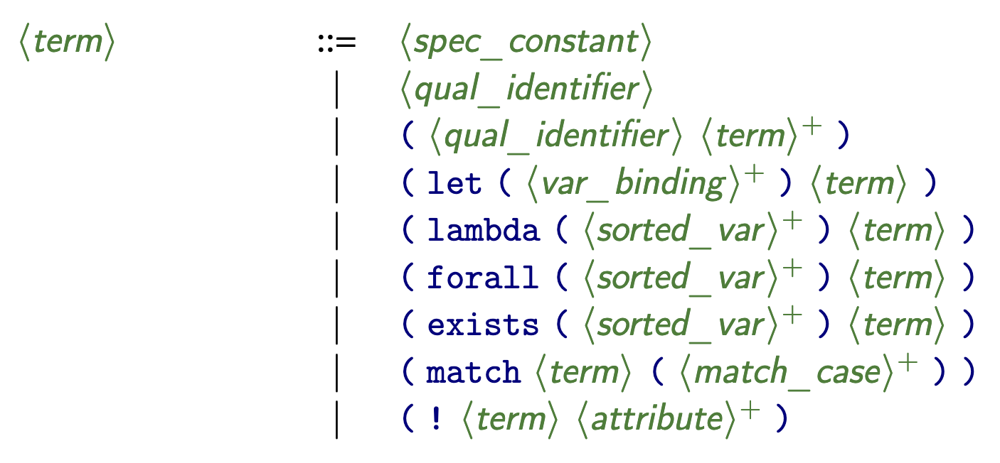

# 2025-03-28 ~ 2025-04-03

Before reading this, you may firstly accept my github invitation (<https://github.com/wuc9521/ll-frontend/invitations>) to the repo, so that you can see the corresponding code.  

## Things I have done this week

1. I implemented a parser (only syntactically) for SyGuS syntax using the elegant Rust `pest` package that Yuantian recommends. Syntax: <https://github.com/wuc9521/ll-frontend/blob/main/src/parser/sygus.v2.pest>

2. I implemented a parser (also syntactically) for our language incrementally. <https://github.com/wuc9521/ll-frontend/blob/main/src/parser/ls.pest>. It’s using some rule variables from SyGuS parser file, which is good for further development I think. A command in our language is either a SyGuS command or our new-defined command

    ```Bash
    LSCmd := SyGuSCmd
        |   SignatureDef
        |   FuncDecl
        |   QVarDecl
        |   ModelDef
    ```

    A complete example of our language: <https://github.com/wuc9521/ll-frontend/blob/main/examples/ll/graph.smt>. It uses smt extension so far for the convenience of my development (syntax highlight).

    `synth-fun` in our language is exactly the same as SyGuS. The differences to SyGuS are `define-signature`, `declare-fun`, `declare-qvar` and `define-model`. But the syntax of `declare-fun` is same as that in SMT-lib, even there are no such command in SyGuS.

3. I also implemented a parser (syntactically) for SMT-lib v2.7 accidentally at first, it was because I thought I was reading SyGuS manual, but turned out to be reading SMT-lib manual. See file: <https://github.com/wuc9521/ll-frontend/blob/main/src/parser/smtlib.v2.pest>. But this actually helped me figure out the relation of SMT-lib and SyGuS. SyGuS is not really inheriting everything from SMT-lib, and I didn't know this before.

4. I read manuals of SMT-lib v2.6, v2.7, SyGuS v2 and SemGus. I assume that we want our command to be at least compatible with SyGuS, and to be similar to SMT-lib as possible. SemGuS also used some commands (`define-funs-rec`) that are not in SyGuS but in SMT-lib

## Problems / Questions

1. How to interpret functions <del>elegantly</del>? My current impl is like this

    ```Lisp
    ;; https://github.com/wuc9521/ll-frontend/blob/main/examples/ll/graph.smt
    ;; universe elements should start with a `$`
    (interp-fun E  
        (   ; similar to pattern maching
            ($b $c true)    ; if 
            ($a _ true)  ; else if
            (_ b false)  ; else if
            (_ _ false)  ; else
        )
    )
    (interp-fun F  
        (   ; allow calling defined funcs
            (x y (not (E x y)))  ;; x and y are variables
        )
    )
    ```

    I noticed that SMT-lib v2.7 (updated 2025 Feb) has added `lambda` expression to their syntax of `Terms`. The syntax of $\lambda$-terms is as follows:

    $$
    \texttt{(lambda (($x_1$ $\tau_1$) ($x_2$ $\tau_2$) $\cdots$ ($x_n$ $\tau_n$)) $t$)}
    $$

    where $x$ are vars and $\tau$ are sorts, $t$ is a term.

    All terms in SMT-lib are

    

    So I really think our `interp-fun` in `define-model` can be expressed using these (`lambda` or `match`). The essential difference is, we want a finite universe (sort) that can be enumerated. To my knowledge, everything in `define-model` other than this can be expressed using syntax either from SyGuS or from SMT-lib.

2. So that gives another problem of `define-univ`. I cannot come up with a good design of enumerating finite universe. If we follow `declare-datatypes` in SMT-lib, we will have exactly what we need now.

    ```Lisp
    (declare-datatypes ((Color 0)) ( 
        (
            (red) 
            (green) 
            (blue) 
        )
    ))
    ```

    Is is a good design to change our `define-univ` to `declare-datatypes` ? Are there any performance concerns this way?

3. I acturally think `define-signature` is useless, so I made it optional. We may just declare everything globally. That makes the code much neater (`define-model` and `synth-fun` does not need signature as an input anymore)

4. What do we want to do with the backend? If I understand correctely, we call existing solvers for some problems and call our solver (that tree automaton) for the rest?

5. On a side note, I find that many SyGuS files are not strictly following their standard manual (syntactically). There are problems of cases like this

    ```Lisp
    (define-fun ((x Int)) Int ....)  ; √
    (define-fun (x Int) Int .... )   ; x but many are in this form
    ```

6. What's our next step?
